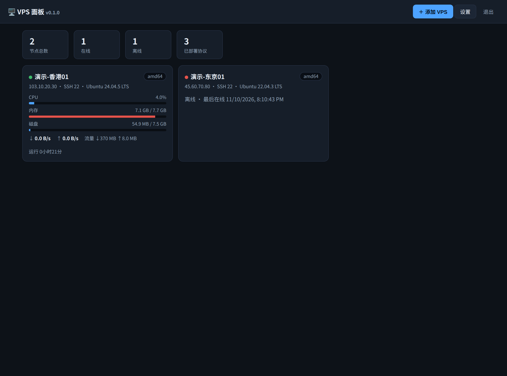
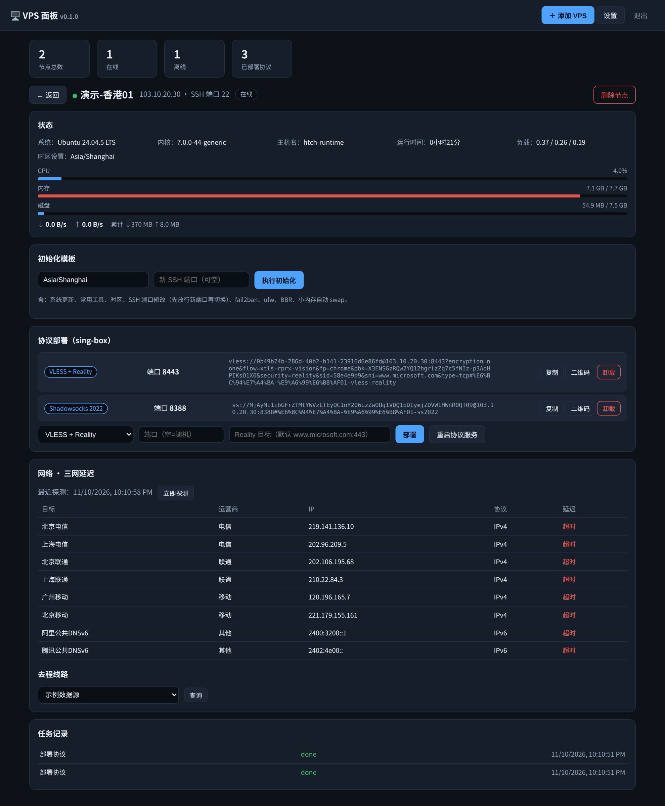

# vps-panel

轻 agent 架构的 VPS 管理面板：状态汇总、三网延迟与线路展示、协议一键部署，对外预留 API。

方案定稿见 [SPEC.md](./SPEC.md)，对外 API 见 [API.md](./API.md)。

## 效果图

节点总览（状态汇总、CPU/内存/磁盘、网速与流量）：



节点详情（状态、协议部署、三网延迟、去程线路、任务记录、VPS初始化）：



> 截图为演示数据；延迟列显示"超时"是因为截图环境禁用了 ICMP，真实 VPS 上显示具体数值。

## 架构

- **面板**（`cmd/panel`）：Go 单二进制，内嵌 Web UI 与各架构 agent 二进制；
  数据（节点、任务、设置）存放在独立数据目录的 `store.json`，更新不丢失。
- **Agent**（`cmd/agent`）：Go 单二进制，装在每台被管 VPS 上，通过 WebSocket
  长连接主动连面板：上报状态、执行三网延迟探测、执行面板下发的任务
  （VPS初始化、sing-box 协议部署）。Agent 不开入站端口。

## 功能

- VPS 接入：IP + SSH 端口 + 密码/密钥 → 面板 SSH 连入安装 agent，凭据不落库
- VPS初始化：系统更新、常用工具、时区（逐台手动指定）、SSH 端口修改
  （先放行新端口→切换→面板验证→关旧端口）、fail2ban、ufw、BBR、小内存自动 swap
- 状态总览：在线、CPU/内存/磁盘、实时网速、累计流量、运行时长
- 三网延迟：电信/联通/移动 IPv4+IPv6 探测，目标可在设置中增删
- 去程线路：数据源可插拔（设置中添加 URL 模板，可自定义增加）
- 协议部署：sing-box 内核，VLESS+Reality、Shadowsocks-2022，参数自动生成，
  分享链接/二维码回收到面板统一管理
- 对外 API：REST + Token 鉴权（见 API.md），供 Hermes 等管理舰队

## 构建

需要 Go ≥ 1.25：

```bash
./scripts/build.sh   # 产物在 dist/（面板 + agent，amd64/arm64）
```

## 在 VPS 上安装面板

```bash
git clone https://github.com/hoolu0/vps-panel.git
cd vps-panel
# 没有 git 也可以：curl -L https://github.com/hoolu0/vps-panel/archive/refs/heads/main.tar.gz | tar xz
sudo ./scripts/install.sh # 代码 /opt/vps-panel，数据 /var/lib/vps-panel
```

本机没有 Go 时，`install.sh` 会自动从 GitHub Release 免登录下载预编译好的
面板二进制（仓库是公开的，只需要 curl 能通 github.com）。Release 由打 tag
自动生成，见 `.github/workflows/release.yml`，例如 `git tag v0.1.0 && git push --tags`。

首次启动的管理员密码在日志里：`journalctl -u vps-panel | grep 管理员密码`，
也可以安装前设置环境变量 `PANEL_ADMIN_PASSWORD` 预设（仅首次生效）。

## 更新

在面板 VPS 的仓库目录里运行一条命令即可，数据不受影响：

```bash
sudo ./scripts/update.sh
```

## 手动安装 agent（可选）

面板接入流程会自动安装。一般无需手动操作；调试时可直接运行：

```bash
vps-agent -panel https://panel.example.com -token <节点token> -data /var/lib/vps-agent
```
